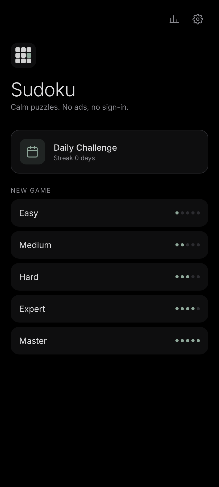
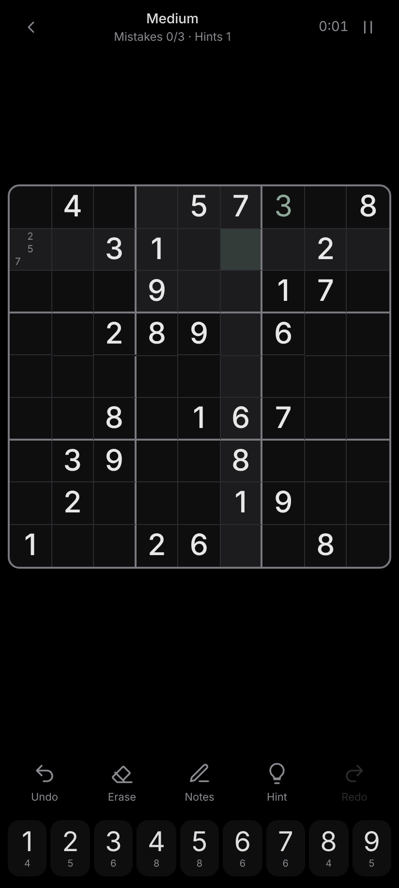
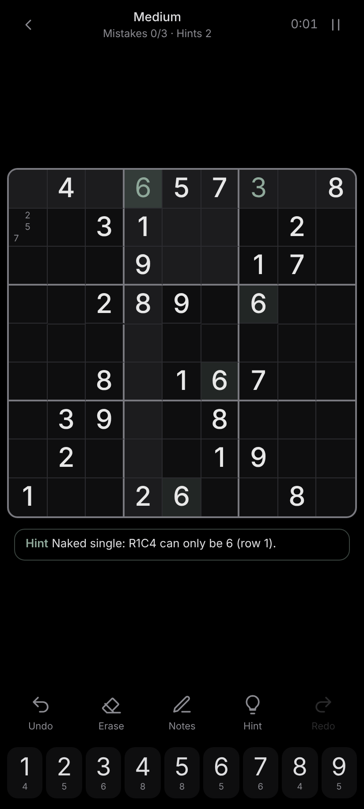
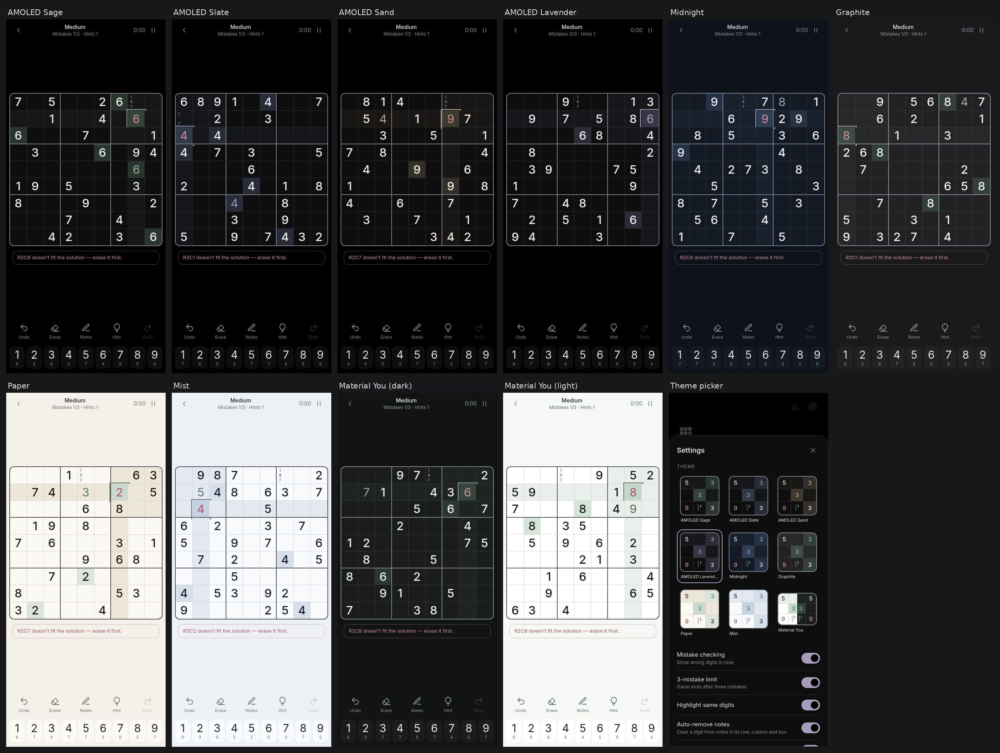
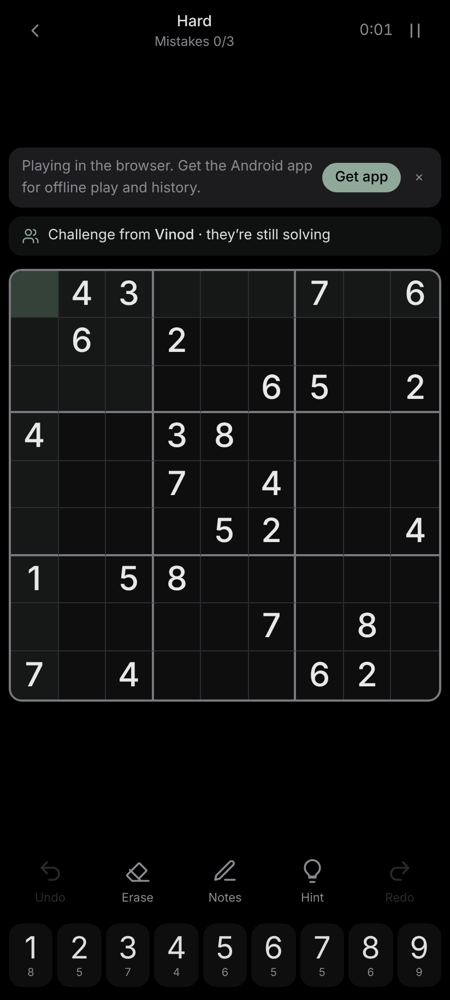
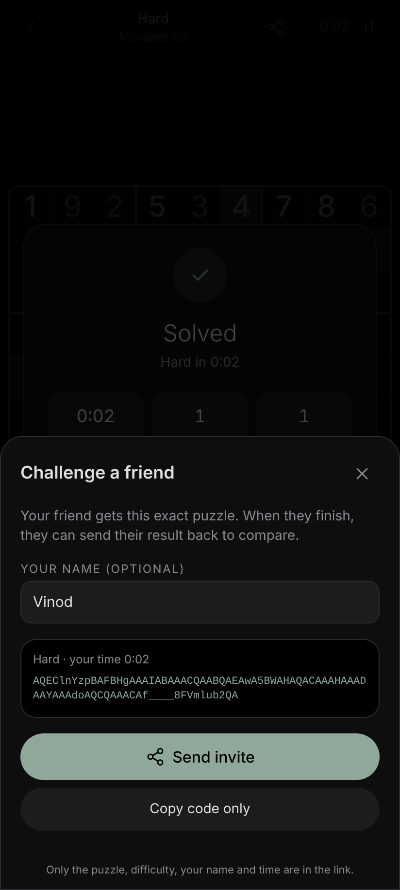
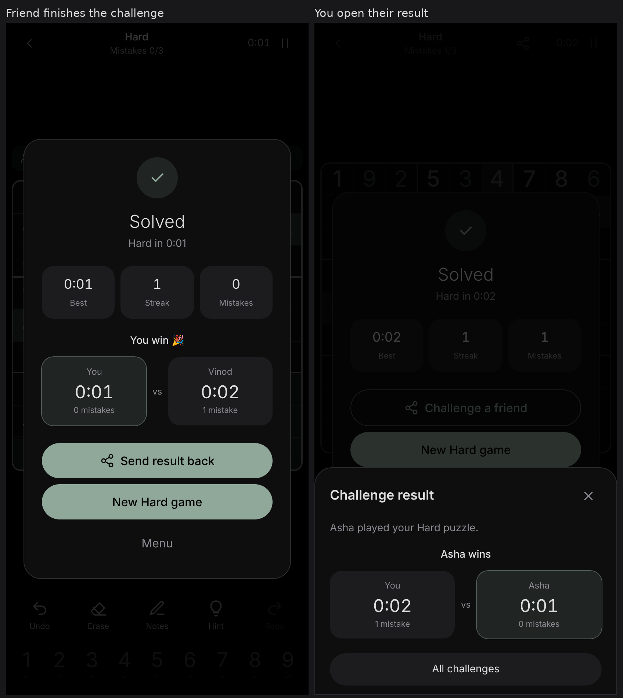

# Sudoku

A calm, ad-free Sudoku for the web and Android, made for Pixel phones. It has an AMOLED true-black theme, smart hints that name the solving technique, a Daily Challenge and stats. There's no sign-in and it works offline.

<p>



</p>



## Features

### New in 1.4

- **E-ink theme** for e-paper phones and readers: white paper, black ink, greys only. Selection is a thick black box, mistakes are struck through with a hatched cell, 3×3 lines are heavier, and all animations, transitions, shadows and blur are switched off to avoid ghosting. System bars go light.

### New in 1.3
- **Play on the web** at https://mvinodk2082-glitch.github.io/sudoku-play/. Invite links are now normal https links that open the puzzle in any browser, so friends don't need the app. A banner offers the APK.
- On Android, tapping an invite link offers **Open with Sudoku**. `sudoku://` links and pasted codes still work.

<p></p>

### New in 1.2
- **Challenge a friend.** Tap the share icon in a game (or "Challenge a friend" after you win) to send your exact puzzle as a `sudoku://play?c=…` link plus a short code. Your friend taps the link or pastes the code into **Join a friend** on home.
- **Compare results.** When your friend finishes, they get a side-by-side card (time and mistakes) and can **Send result back**. Open it and you see who won. Every match is kept under **Challenges** on home.
- **Private by design.** No server and no account. A link carries only the puzzle, the difficulty, your time and an optional name.
- **No repeated puzzles.** Every puzzle you're served is fingerprinted in a way that ignores digit swaps, row and column shuffles and rotations. The same grid in disguise never comes back on any level.

<p> </p>


**Puzzles**
- Every puzzle has exactly one solution. It starts from a randomised backtracking fill, clues are removed in 180°-symmetric pairs, and a solution counter checks that the solution is still unique after each removal.
- There are five difficulties: **Easy, Medium, Hard, Expert, Master**. They're graded by the techniques a human-style logical solver needs, not by clue count:
  - Easy and Medium need only naked and hidden singles. Easy has 36 or more clues.
  - Hard needs naked or hidden pairs, pointing, or box/line reduction.
  - Expert needs naked triples, X-Wing or XY-Wing.
  - Master is beyond all of the above.
- Generation runs in a Web Worker, so the UI never stalls. Expert and Master puzzles fall back to a precomputed bank made by the same generator. Each one gets a random digit, row, column and transpose transform, which keeps it unique and keeps its grade.
- The **Daily Challenge** is seeded from the date, so everyone gets the same puzzle that day.

**Play**
- Tap a cell, then a number. The keyboard works too: 1–9, arrows, Backspace/Delete, N for notes, H for a hint, Space to pause, Ctrl+Z and Ctrl+Y.
- Notes mode. Placing a digit removes it from the notes in its row, column and box automatically.
- The selected row, column and box are highlighted, along with every cell holding the same digit.
- Mistake checking can be turned on or off, with an optional 3-mistake limit. You also get unlimited undo/redo and an eraser.
- **Smart hints** explain the step, for example "Hidden single in box 3: 7 fits only at R2C8" or "After Pointing eliminations: …". A hint tells you first if one of your entries is wrong.
- The number pad shows how many of each digit are left and greys out finished digits.
- A timer with pause that blurs the board. The game also pauses automatically when the app goes to the background.
- Progress auto-saves to localStorage, so you can resume any time.

**Stats**
- For each difficulty: games played, win rate, best and average time, and current and best streak.
- A daily-challenge calendar with current and best daily streaks.

**Design and accessibility**
- AMOLED true black `#000000`, soft greys and one muted sage accent `#8FA89A`. Given digits are soft white, your digits are sage and errors are muted rose.
- Thick 3×3 lines and large digits. Subtle animations: cells pop in, a completed row, column or box glows gently, and the win screen is calm.
- **Ten themes** with a live mini-board preview in Settings: AMOLED Sage (default), AMOLED Slate, AMOLED Sand, AMOLED Lavender, Midnight, Graphite, Paper, Mist, E-ink, and Material You, which follows your phone's light or dark mode. The Android status and navigation bars match the theme. Haptics are optional and off by default.
- The number pad sits at the bottom so you can play one-handed.
- ARIA grid and cell labels, a live region for announcements, and focus-visible outlines.

**Offline / PWA**: a web manifest and service worker, so it installs to the home screen.

## Project layout

```
src/engine/   solver.ts (backtracking + solution counter), logic.ts (technique solver + hints),
              generator.ts (carving, grading, daily seed), worker.ts, bank.json, __tests__/
src/game/     store.ts (reducer, undo/redo, persistence, stats), generate.ts (worker client)
src/          App.tsx, Board.tsx, ui.tsx, index.css
android/      Capacitor Android project (appId com.mvinod.sudoku)
scripts/      build-bank.ts (Expert/Master bank), icons.py (icon renderer)
```

## Build

```bash
npm install
npm test               # vitest: generator, solver, uniqueness, grading
npm run dev            # web dev server
npm run build          # production web build in dist/
```

### Android APK

You need JDK 21 and the Android SDK (compileSdk 35). R8 minify and resource shrinking are on for release builds. The signing keystore is **not** in this repo. Pass it in with environment variables or `~/.gradle/gradle.properties`:

```bash
export SUDOKU_STORE_FILE=/path/to/sudoku-release.jks SUDOKU_STORE_PASSWORD=… SUDOKU_KEY_ALIAS=sudoku SUDOKU_KEY_PASSWORD=…
npm run build && npx cap sync android
cd android && ./gradlew assembleRelease   # app/build/outputs/apk/release/app-release.apk
```

The minimum Android version is 7.0 (API 24). The adaptive icon has a monochrome layer, so it works with Pixel themed icons.

## Publishing the web version

`scripts/publish-web.sh` rebuilds the app and pushes only `dist/` (plus a `404.html` fallback and `web-publish/README.md`) to the public repo [`sudoku-play`](https://github.com/mvinodk2082-glitch/sudoku-play), which GitHub Pages serves from `main`. It needs `gh` to be logged in. No source code or keys are published.

## Download

**▶ Play in the browser: https://mvinodk2082-glitch.github.io/sudoku-play/**

**[⬇ Download Sudoku 1.4 APK](https://github.com/mvinodk2082-glitch/Sudoku/releases/download/v1.4/Sudoku-1.4-release.apk)** (1.23 MB). It's also in [`releases/`](releases/Sudoku-1.4-release.apk).
SHA-256: `8d6c5566d2577d27791a84492bf2a87acd082e3b23cdf6a9bf9a23cd96b5b2e0`

SHA-256: `9fde731c63420d2fe540447352ebe45c71cc2a57edb99b965670175d7a5066b6`

To install, open the link on your phone and allow "Install unknown apps" for your browser or Files app. You don't need developer mode.
